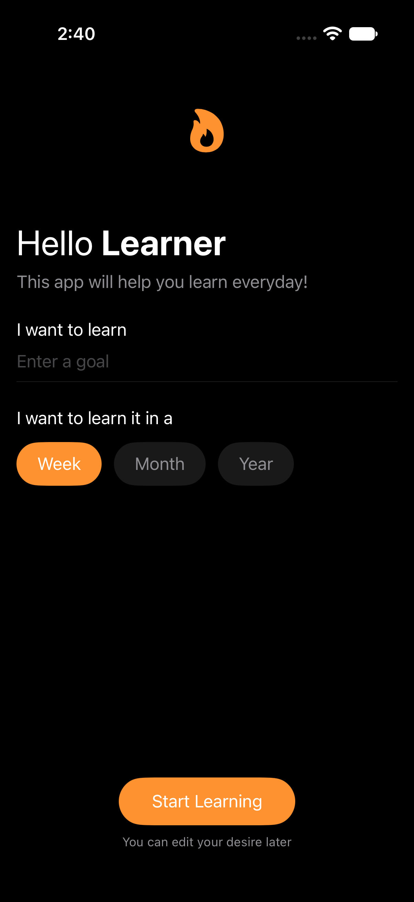
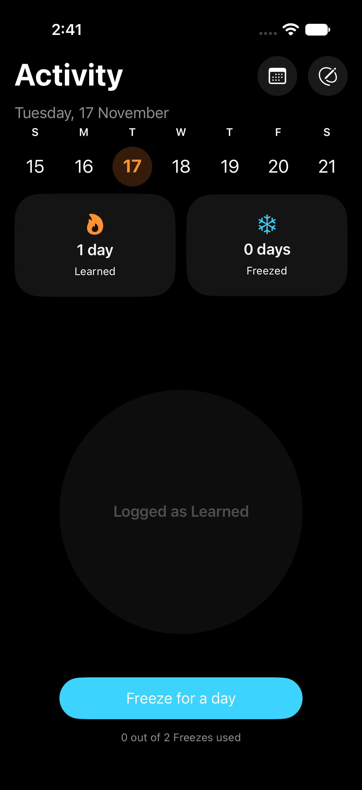

# Learning Journey

Learning Journey is a SwiftUI app that helps you build a daily learning habit. Set a goal, log each day as learned (or freeze a day when you need a break), and track your progress in a calendar.

## Main features

- **Set a goal:** choose what you want to learn and for how long (Week, Month, or Year).
- **Log every day:** tap *Log as Learned*, or *Freeze for a day* if you can't study.
- **Change your mind:** today can be switched between learned and frozen.
- **Week strip:** this week at a glance. Learned days are orange, frozen days are blue.
- **Counters:** how many days you learned and how many you froze.
- **Calendar:** a view-only history of all your previous days.
- **Goal result:** when the goal ends, the app tells you whether you completed it.
- **Edit your goal:** change the topic or the length at any time (your counters start over).
- **Saved on your device:** close the app and come back to the same goal.

## Screenshots

| Set a goal | Activity |
|---|---|
|  |  |

## Technologies used

- SwiftUI and the `@Observable` macro (iOS 17 or later)
- **MVVM:** models hold the data, views only display it, and view models hold the logic
- `Codable` and `UserDefaults` for saving (`GoalStore`)
- An app icon made with Icon Composer

